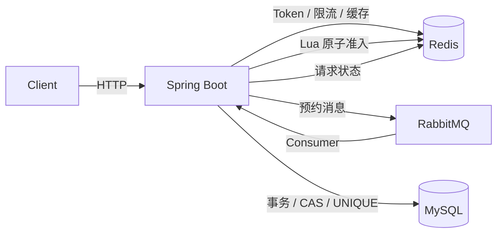
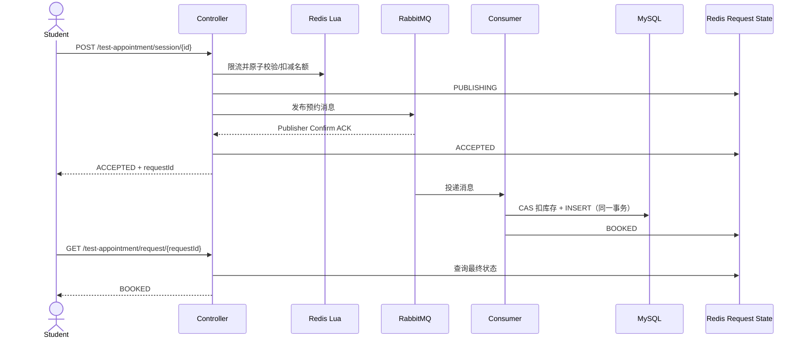

# SmartFitness - 智慧体测与高并发预约平台

面向高校体测场景，提供用户、班级、体测项目、体测记录和限量场次预约，并针对集中开放预约时的并发场景实现 Redis + Lua + RabbitMQ 预约链路。

## 技术栈

Java、Spring Boot 2.3.12.RELEASE、MyBatis-Plus 3.4.3、MySQL 8、Redis、Redisson 3.13.6、RabbitMQ、Lua、Maven。

`pom.xml` 的 Maven target 仍为 Java 8；本项目实际开发和验证使用 JDK 17。该表述不代表已升级到 Java 17 字节码。

## 核心业务模块

- 用户认证：学生注册、三类角色登录、Redis Token 与请求用户上下文。
- 组织与班级：学院、行政班级、学生档案。
- 体测项目：项目维护、启停和热点详情缓存。
- 体测记录：教师/管理员录入，学生查看本人记录。
- 体测场次：草稿、发布、关闭、取消及预约窗口管理。
- 限量预约：Lua 准入、RabbitMQ 异步落库、状态查询和取消。

## 架构设计

预约主链为 `HTTP -> Redis ZSET 限流 -> Redis Lua 准入 -> RabbitMQ -> Consumer -> MySQL`，Redis 同时保存异步请求状态。

## 高并发预约流程

`ACCEPTED` 只表示 Broker 已受理，不表示数据库预约已完成；客户端必须用 `requestId` 查询 `BOOKED` 等最终状态。

## 可靠性设计

- Redis Lua 在单次脚本内校验场次、时间、重复预约与库存并扣减，承担高并发入口准入。
- MySQL 条件 UPDATE 仍以 `available_quota > 0` 作最终防超卖；扣库存与预约 INSERT 在同一事务。
- `UNIQUE(user_id, session_id)` 保证一个学生对同一场次最多一条记录，`request_id` 保证消费请求幂等。
- Publisher Confirm 与 Return 区分明确失败和状态未知；Confirm 超时只标记 `UNKNOWN`，不贸然回滚 Redis。
- 主队列消费失败最多重试 3 次，再进入 DLQ。DLQ 先查 MySQL：已落库则修复 `BOOKED`，确认未落库才执行幂等 Redis rollback 并标记 `FAILED`。

## 缓存设计

TestItem 详情采用 Cache Aside：空值缓存防穿透，Redisson 锁抑制热点失效时的并发回源，正常 TTL 加随机抖动缓解集中失效。写操作提交 MySQL 事务后删除 Redis，避免事务回滚时误删；这是最终一致方案，不是强一致缓存。

## 分布式限流

Redis ZSET + Lua 实现滑动窗口。登录同时按 IP 和规范化 username 限流；预约按 userId 限流。登录限流在 Redis 异常时 fail open，避免保护组件锁死登录入口；预约准入 fail closed，避免绕过库存控制。Guava 只能约束单进程，不能在多实例间共享计数，因此未作为最终限流实现。

## 快速启动

1. 准备 MySQL 8（默认 `3306`）、Redis（默认 `6379`）和 RabbitMQ（AMQP 默认 `5672`）。
2. 在目标数据库依次执行 `src/main/resources/db/smart_fitness.sql`；开发环境可再执行 `dev_seed.sql`。
3. 在系统环境中设置 `DB_HOST`、`DB_PORT`、`DB_NAME`、`DB_USERNAME`、`DB_PASSWORD`、`REDIS_HOST`、`REDIS_PORT`、`RABBITMQ_HOST`、`RABBITMQ_PORT`、`RABBITMQ_USERNAME`、`RABBITMQ_PASSWORD`。默认端口见上一步；敏感配置由环境变量提供。
4. 使用 JDK 17 执行 `mvn spring-boot:run`，应用默认监听 `8081`。

数据库脚本位于 `src/main/resources/db/`；接口定义、Redis Key 和 RabbitMQ 拓扑分别见 `controller/`、`utils/RedisConstants.java` 与 `config/RabbitMqConstants.java`。
